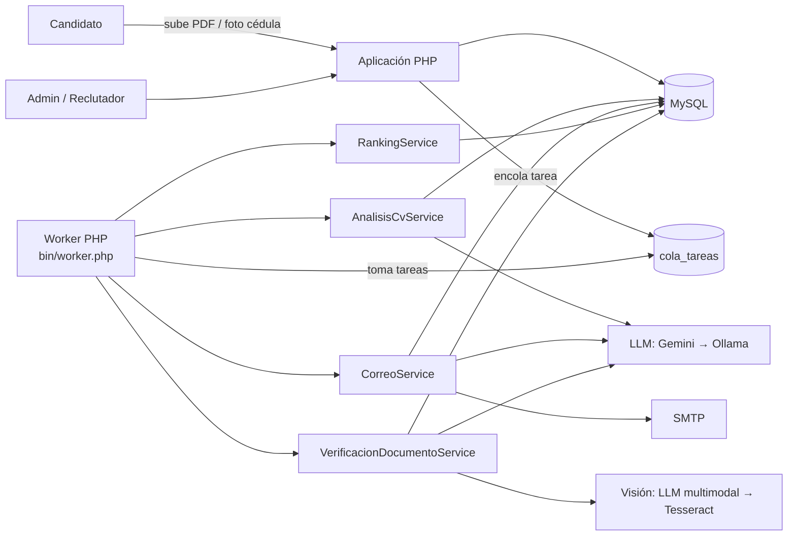

# TALENTIA – Documento técnico (Tercer corte) · BORRADOR
> Máximo 10 páginas en la entrega final. Completa los campos marcados con [ ].

## 1. Arquitectura final

Pila: PHP 8.2 + Apache, MariaDB/MySQL, Docker, Gemini (nivel gratuito), Ollama (local), Tesseract, PHPMailer, PHPUnit. Todo gratuito o de código abierto.

## 2. Inventario de flujos migrados de n8n
| Flujo n8n | Disparador n8n | Pasos | Servicio en código | Resultado |
|---|---|---|---|---|
| 1. Analizar CV | Webhook `talentia-analizar-cv` | descargar PDF → extraer texto → Gemini → validar JSON → guardar → estados | `AnalisisCvService` (tarea `analizar_cv`) | fila en `analisis_ia`, estado del candidato |
| 2. Correo | Webhook `talentia-enviar-correo` | consultar puntuación → If ≥80 → Gemini redacta → SMTP → registrar | `CorreoService` (tarea `enviar_correo`) | fila en `correos_enviados` con fecha y estado |
| 3. Ranking | Webhook `talentia-actualizar-ranking` | `CALL sp_actualizar_ranking()` | `RankingService` (tarea `actualizar_ranking`) | tabla `ranking` |

**Qué cambió:** el webhook es ahora una fila en `cola_tareas`; los nodos son métodos PHP; "Executions" de n8n es la tabla `ejecuciones_log` (pantalla *Automatización*).
**Mejoras sobre n8n:** reintentos con espera creciente (30 s, 2 min, 10 min, 30 min), tareas idempotentes (un reintento no duplica análisis ni correos), recuperación de tareas colgadas, plan B de IA, auditoría.

## 3. Manejo de errores, reintentos y registro
- `Queue::ejecutarUna` captura toda excepción: reintenta hasta `max_intentos` (4) y luego marca `fallida`; un administrador puede reprogramarla desde la pantalla.
- Cada ejecución queda en `ejecuciones_log` (fecha, flujo, entrada, resultado, duración, estado).
- Si el CV agota sus reintentos, el candidato queda en estado `error`; si es un documento, pasa a `revision_manual` (lo decide una persona).

## 4. Módulo de visión (verificación de documentos)
- **Proceso de negocio:** el candidato sube foto de su cédula → el sistema extrae número, nombres y apellidos → los compara con lo que registró → decide.
- **Decisión de la IA** (`Decision::estadoDocumento`): `validado` (confianza ≥ 0,75 y coinciden documento y nombre), `rechazado` (confianza ≥ 0,75 y nada coincide) o `revision_manual` (confianza baja o coincidencia parcial).
- **Cuando se equivoca:** nunca decide sola en los casos dudosos; un reclutador ve la foto junto a los datos extraídos y aprueba o rechaza (queda su id y fecha).
- **Salida estructurada:** JSON con `numero_documento`, `nombres`, `apellidos` y confianza por campo; la confianza global es la del campo menos confiable.
- **Disparo del proceso:** al quedar `validado`/`rechazado` se encola `notificar_documento` y se actualiza `candidatos.documento_verificado`.
- **Proveedores:** modelo multimodal (Ollama local o Gemini solo si el candidato lo autorizó) → Tesseract local con reglas.

### Resultados de las pruebas con imágenes reales
Ejecutar `php bin/evaluar_vision.php` (ver README) y pegar aquí:
| Campo | Aciertos | % |
|---|---|---|
| numero_documento | [ ]/[ ] | [ ] |
| nombres | [ ]/[ ] | [ ] |
| apellidos | [ ]/[ ] | [ ] |
Imágenes: [20+] fotos con celular, variando luz, ángulo y fondo. Proveedor usado: [ ]. Errores típicos observados: [ ].

### Pruebas unitarias
`composer test` → [ ] pruebas, [ ] aserciones. Cubren: regla de umbral 80, decisión del documento, espera entre reintentos, validación del JSON de la IA, comparación de nombres/documentos y plan B del cliente de IA.

## 5. Seguridad
- **Roles:** `candidato` (sesión tras registrarse; solo sube su CV y su documento), `reclutador` (ve ranking, análisis, correos, documentos y decide revisiones), `admin` (además ve y ejecuta el motor y la auditoría).
- **Auditoría de IA:** `auditoria_ia` registra cada llamada (acción, proveedor, modelo, candidato, hash SHA-256 de la entrada, estado, duración). No guarda el contenido.
- **Claves:** solo en `.env` / variables de entorno; `.env` está en `.gitignore`.
- Consultas preparadas (PDO), CSRF en formularios, validación de tipo MIME y firma del archivo, nombres aleatorios, `storage/` fuera de la carpeta pública, imágenes servidas solo con sesión de personal, `password_hash`.
- Registro de quién subió cada imagen y cuándo (`subido_por_*`, `ip`, `creado_en`).

## 6. Protección de datos personales (Ley 1581 de 2012)
| Dato | Dónde | Finalidad |
|---|---|---|
| Nombre, correo, teléfono, ciudad | `candidatos` | contactar y gestionar la postulación |
| Número de documento y foto de la cédula | `candidatos`, `documentos_identidad`, `storage/docs` | verificar identidad |
| Hoja de vida (formación, experiencia) | `hojas_vida`, `storage/cv` | evaluar la postulación |

- **Autorización previa:** el formulario exige marcar la autorización (finalidad, uso de IA y derechos del titular); se guarda `autorizacion_datos` y su fecha.
- **Finalidad:** solo evaluación de la postulación y comunicación con el candidato.
- **Seguridad:** accesos por rol, imágenes sin URL pública, claves en variables de entorno, auditoría.
- **Datos de la cédula y servicios externos:** por defecto se procesan en el servidor (Ollama/Tesseract). Gemini solo se usa si el candidato marca una autorización adicional y específica (`autorizo_externo`).
- **Datos en los registros:** el log y la auditoría no guardan nombres ni números de documento (solo estado, confianza y hash).
- **Derechos del titular:** consultar, corregir y suprimir; [definir el correo/procedimiento del responsable del tratamiento].
- Pendiente recomendable: política de retención (borrar fotos de cédula tras [ ] días).

## 7. Plan B ante fallos
| Falla | Qué hace el sistema |
|---|---|
| Gemini sin cuota / sin red | pasa a Ollama (modelo local) y lo audita como `fallback` |
| Todos los modelos fallan | la tarea se reintenta con espera creciente; si se agotan, queda `fallida` y el admin la reprograma |
| Visión no puede leer | Tesseract local; si tampoco, el documento pasa a revisión manual |
| SMTP caído | el correo ya redactado queda `pendiente` y se reintenta sin volver a gastar IA |
| Worker caído | las tareas quedan en cola; las "colgadas" se recuperan a los 10 min |

## 8. Limitaciones conocidas
[Completa con lo que observes. Sugerencias:] CV escaneados dependen del modelo; la cuota gratuita limita peticiones/minuto; el OCR local es poco fiable con reflejos; no hay política de retención automática; el chatbot [ ].
