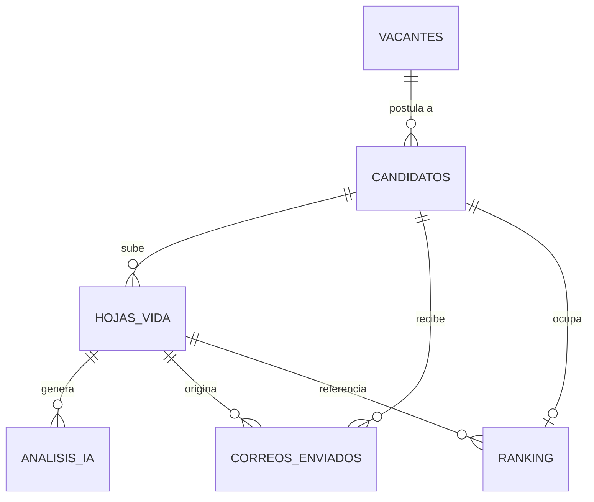

# TALENTIA – Sistema Inteligente de Reclutamiento y Selección

## Instalación (Windows + XAMPP)
1. Copia la carpeta a `C:\xampp\htdocs\talentia`.
2. Inicia **Apache** y **MySQL** en XAMPP. En phpMyAdmin → Importar → `database/talentia.sql`.
3. Revisa `config/config.php` (BASE_URL, credenciales BD, `N8N_SECRET`).
4. Levanta n8n con Docker y configura los workflows según `docs/N8N_WORKFLOWS.md`.
5. Abre http://localhost/talentia/public/ · Admin: `admin@talentia.local` / `Admin123*` (cámbiala).
6. En `php.ini` confirma `extension=fileinfo` y `extension=curl`, y `upload_max_filesize=8M`.

## Arquitectura
```
Navegador ─► Apache/PHP (MVC) ─► MySQL
                │  ▲                ▲
   webhook JSON │  │ PDF por token  │ INSERT/UPDATE
                ▼  │                │
              n8n (Docker) ─► OpenAI/Gemini ─► SMTP
```
MVC: `public/index.php` (front controller) → `app/controllers` → `app/models` → `app/views`.

## Modelo entidad–relación


## Seguridad aplicada
Consultas preparadas (PDO), CSRF en formularios, validación MIME + firma `%PDF-`, nombres aleatorios, `storage/` fuera de `public/`
(PDF servido por token HMAC), contraseñas con `password_hash`, usuario MySQL de n8n con permisos mínimos.
